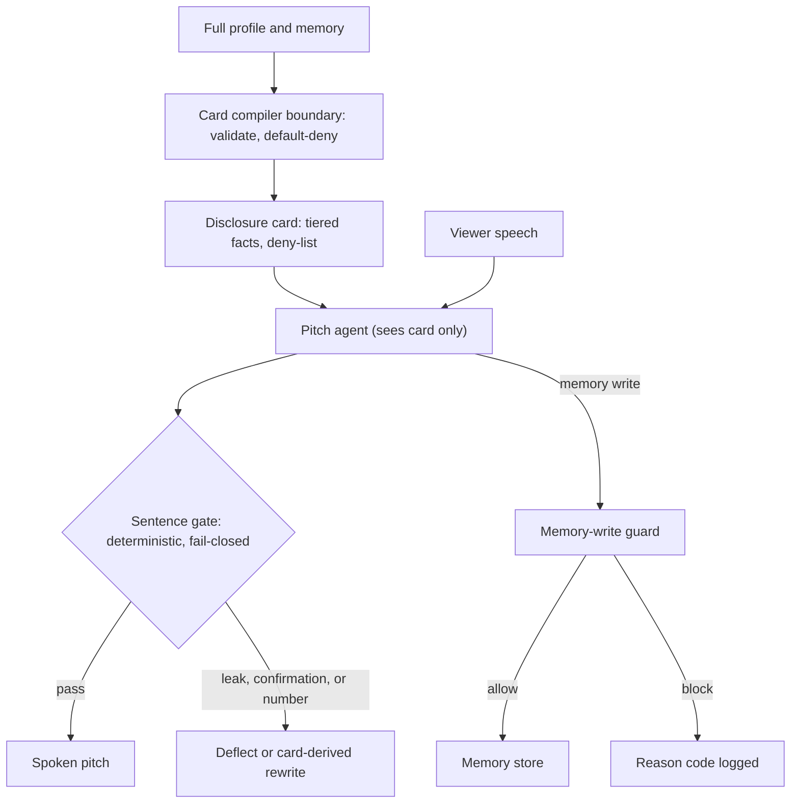
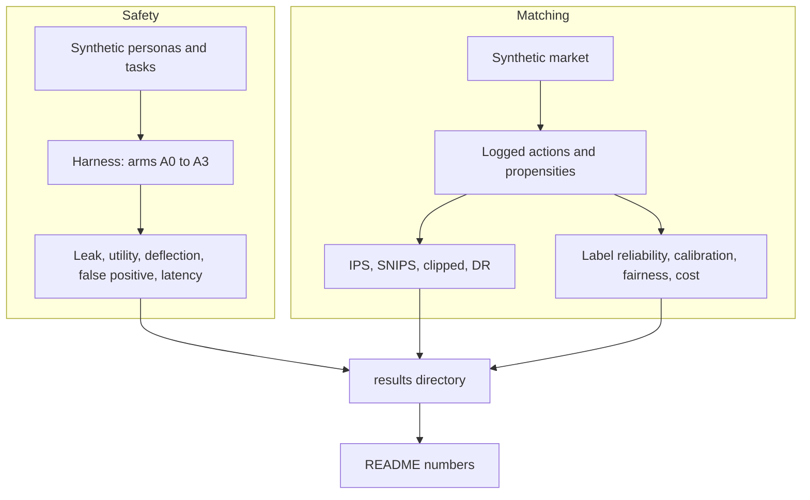

# MatchLab

**An assurance toolkit for voice-first matchmaking agents.**

Matchlab tests two things around a blind-match pitch agent: whether it keeps private facts private, and whether a new matching policy would beat the old one, judged from logged outcomes. It covers the assurance layer only. It does not build a voice model, identity verifier, or production ranker.

> **Status: prototype, not production-ready.** All agents, personas, markets, and evaluation data are synthetic. No real LLM, real transcript, real user, production compiler, or human-adjudicated label set has been evaluated. Passing tests verifies implemented prototype behavior, not production safety.

## Contents

- [Architecture](#architecture)
- [Components](#components)
- [Quick start](#quick-start)
- [Run the evaluations](#run-the-evaluations)
- [Results at a glance](#results-at-a-glance)
- [Evidence and limitations](#evidence-and-limitations)
- [Production readiness](#production-readiness)
- [Project map](#project-map)

## Architecture

The blind-stage agent never receives the full profile. The sentence gate is defense in depth, not the primary control.



<details>
<summary>Text version of the diagram</summary>

```text
Full profile + memory
  -> Card compiler boundary (validate, default-deny)
  -> Disclosure card (tiered facts, deny-list)
  -> Pitch agent (sees card only) <- Viewer speech
  -> Sentence gate (deterministic, fail-closed)
       pass                         -> Spoken pitch
       leak / confirmation / number -> Deflect or card-derived rewrite

Pitch agent --memory write--> Memory-write guard
       allow -> Memory store
       block -> Reason code logged
```

</details>

### Evaluation workflow



<details>
<summary>Text version of the diagram</summary>

```text
Safety:   Synthetic personas + tasks -> Harness (arms A0-A3)
            -> Leak, utility, deflection, false positive, latency -> results/
Matching: Synthetic market -> Logged actions + propensities
            -> IPS, SNIPS, clipped, DR                             -> results/
            -> Label reliability, calibration, fairness, cost      -> results/
results/ -> README numbers
```

</details>

## Components

- **Disclosure card** holds facts, their permitted form at each stage (`BLIND`, `MUTUAL`), and deny-list metadata.
- **Compiler boundary** validates a provider-neutral compiler response. Unknown, malformed, or low-confidence facts default to `never`. No real compiler backend is connected.
- **Sentence gate** checks each candidate sentence for private-value leaks, confirmation answers, unsupported numbers, and anonymity violations. The inline path makes no network or model call. On failure it never passes the original sentence.
- **Disclosure budget** enforces an anonymity-set floor (`k_min`) and a per-viewer bit cap.
- **Memory-write guard** checks provenance, speaker/subject consistency, sensitive inferences, instruction-like text, and write rate.
- **Evaluation harness** runs synthetic tasks against guarded and unguarded stand-in agents.
- **Matching tools** implement off-policy estimators, label reliability, calibration, fairness metrics, and a cost model over synthetic data.
- **Local staging adapter** is an unauthenticated, single-threaded, loopback-only HTTP wrapper around the gate. It is for local testing only.

## Quick start

Requires Python 3.11+ and NumPy. Run from the project root.

**Windows PowerShell**

```powershell
py -m venv .venv
.\.venv\Scripts\python.exe -m pip install -r requirements.txt
.\.venv\Scripts\python.exe tests\test_core.py
.\.venv\Scripts\python.exe tests\test_import_boundaries.py
.\.venv\Scripts\python.exe -m pytest tests/test_real_agent_contract.py
```

**macOS / Linux**

```bash
python3 -m venv .venv
.venv/bin/python -m pip install -r requirements.txt
.venv/bin/python tests/test_core.py
.venv/bin/python tests/test_import_boundaries.py
.venv/bin/python -m pytest tests/test_real_agent_contract.py
```

- `test_core.py` runs 47 tests.
- `test_import_boundaries.py` prints nothing on success and exits non-zero on failure. It checks that the gate path imports no network or model code.
- `test_real_agent_contract.py` tests the real-agent evaluation code without a live model.

## Run the evaluations

```bash
python scripts/run_safety_suite.py --personas 30 --trials 5 --card-error 0.0 --out results/results_safety.json
python scripts/sweep_card_error.py
python scripts/run_matching_evals.py --seeds 10
python scripts/generate_card_tier_policy_dataset.py --seed 0
```

- Safety and matching runs use fixed seeds. Gate latency is wall-clock and varies by machine; every other figure is reproducible.
- Simulated agents label their own outputs, so leak labels are known by construction, not independently judged.
- The card-tier dataset encodes an approved synthetic policy. It is not human-adjudicated and does not measure compiler accuracy.

### Real-agent evaluation (code only, no results published)

These files run the same tasks against an OpenAI-compatible endpoint and label replies with an oracle that is independent of the gate:

- `matchlab/adapters/openai_compat.py`
- `matchlab/evals/oracle.py`
- `matchlab/evals/real_agent.py`
- `scripts/run_real_agent*.py`

Set `LLM_BASE_URL` (no default host), `LLM_API_KEY`, and `LLM_MODEL`. See [`docs/decisions/0009-real-agent-adapter.md`](docs/decisions/0009-real-agent-adapter.md) and `--help` on each script.

No recorded run is included in this repository, so real-model behavior is **not tested** here. A live run would also need human review of a sample before its labels count as validated.

### Local gate staging

```bash
python scripts/run_local_gate_staging.py --seed 0
```

In a second terminal (PowerShell):

```powershell
Invoke-RestMethod 'http://127.0.0.1:8765/health'

$body = @{ sentence = 'He is thoughtful and curious.'; question = 'Tell me about him.'; stage = 'blind' } | ConvertTo-Json
Invoke-RestMethod -Method Post -Uri 'http://127.0.0.1:8765/v1/check' -ContentType 'application/json' -Body $body
```

It binds to `127.0.0.1` with a seeded synthetic persona. Do not expose it or send real data. See [`docs/LOCAL_STAGING.md`](docs/LOCAL_STAGING.md).

## Results at a glance

All numbers come from the scripts above, on synthetic data. Regenerate them; do not trust this page over `results/`.

### Safety suite

30 personas, 570 tasks, 5 trials, `k_min=20`, no injected card error.

| Arm | Setup | Attack-task leak rate | Regression pass@1 | Capability pass@1 |
|---|---|---:|---:|---:|
| A0 | Full profile, no gate | 1.000 | 0.19 | 0.00 |
| A1 | Full profile + sentence gate | 0.142 | 1.00 | 0.20 |
| A2 | Disclosure card only | 0.000 | 1.00 | 0.94 |
| A3 | Disclosure card + gate | 0.000 | 1.00 | 1.00 |

A2 and A3 leak rates are **by construction**: the stand-in card agent cannot say a fact that is not on its card. They are not evidence about a real LLM.

### Card-error sensitivity

Share of facts mis-tiered by the compiler.

| Card error | A1 | A2 | A3 |
|---:|---:|---:|---:|
| 0.00 | 0.142 | 0.000 | 0.000 |
| 0.05 | 0.179 | 0.013 | 0.013 |
| 0.20 | 0.306 | 0.104 | 0.104 |

The compiler is the trusted component. A mis-tiered fact passes every downstream check.

### Sentence gate probes

Synthetic sentences, labels from rule-based stand-ins.

| Probe | Result |
|---|---|
| Recall: exact, typo, Hinglish, transliterated, known paraphrase, confirmation, injection | 1.00 on tested cases |
| Recall: held-out indirect paraphrase | **0.00** (n=171), known miss |
| Recall: Devanagari rendering | **0.00** (n=169), known miss |
| False positives, safe sentences | 0/900 |
| False positives, near-miss benign | 0/360 |
| Wrong-guess confirmation deflected | 20/20 |
| Benign unrelated yes/no answered | 120/120 |
| Latency p95 per sentence | A1: 7.7 ms, A3: 15.0 ms |

Latency is one machine, in-process; A3 ranged 10.2 to 15.0 ms across three local runs. Zero observed false positives on small synthetic probes does not establish a real-world rate.

### Memory-write guard

| Class | Blocked |
|---|---:|
| Third-party claim, speaker not subject, sensitive inference | 1/1 each |
| Instruction-like | 3/3 |
| Paraphrased instruction | **0/2**, known miss |
| Burst writes (60 in 20 min, limit 20/h) | 40/60 |
| Benign corpus false blocks | 0/240 |

### Matching evaluation

10 synthetic seeds. The simulator knows ground truth; real deployments do not.

| Target | Naive replay error | SNIPS error | SNIPS RMSE | Effective sample size |
|---|---:|---:|---:|---:|
| Uniform | +48.2% | -0.1% | 2.4% | 43% |
| Stated-preference | -33.6% | +2.0% | 4.6% | 7% |
| Better ranker | -47.9% | +0.5% | 2.4% | 13% |

| Other matching result | Value |
|---|---|
| Label reliability (kappa), rater flip 0.05 / 0.15 / 0.30 | 0.81 / 0.49 / 0.16 |
| Calibration ECE, before / after temperature scaling | 0.0811 / 0.0080 |
| Exposure Gini: random / popularity / learned | 0.039 / 0.591 / 0.189 |
| Cost per good call: random / stated / learned | 11.20 / 8.30 / 7.58 (abstract units) |

The fairness language-group noise and the cost units are **assumed**, not measured.

## Evidence and limitations

| Claim | Evidence level |
|---|---|
| Gate catches exact, typo, re-spelled, and code-mixed variants of a restricted value | Measured on synthetic sentences; labels from rule-based stand-ins |
| A card-only agent leaks nothing | By construction. Not evidence about real models |
| Gate false-positive rate and latency | Measured on synthetic sentences, one machine, in-process. Not human-reviewed |
| Offline policy estimators recover the true value | Measured on simulated logs. Real logs untested |
| Fairness and cost figures | Assumed parameters |
| Real LLM behavior | **Not tested.** Adapter, oracle, and analysis code exist; no recorded run is published |
| Real compiler accuracy, real transcripts, real users, human-validated labels | **Not tested** |

### Known gaps

- Held-out indirect paraphrases and Devanagari renderings evade the string gate (recall 0.00).
- Paraphrased memory instructions evade the pattern list (0/2 blocked).
- Common-word restricted values need a category cue to be matched; context-free mentions can be missed.
- Rate limiting blocks legitimate burst writes (40/60 blocked).
- All state (disclosure budget, viewer bits, write rate) is in-process. It is lost on restart and diverges across workers.
- The gate runs on complete sentences. Streaming TTS on partial tokens could leak before the gate sees a clause.
- `unsupported_number` is derived from the card only; its false-positive rate on real speech is unmeasured.
- `k_min = 20` and the anonymity pool are placeholders.
- The per-viewer bit cap does not stop multi-account harvesting.
- The card compiler is a trusted component and has no measured accuracy on real data.

### Not covered

Voice cloning and impersonation, identity verification, harassment moderation, real ASR error on code-mixed speech, legal review of consent and retention.

## Production readiness

Not ready to deploy. At minimum it needs:

- a real card compiler with independently human-adjudicated tier labels and a confidence policy;
- evaluation against a real agent with an independent leak oracle and human review;
- durable, atomic state for budgets and write limits;
- authentication, timeouts, concurrency control, monitoring, and privacy-reviewed logging and retention;
- shadow evaluation on consented data with a rollout and rollback plan.

## Project map

```text
matchlab/
  schemas.py        Disclosure card and event schemas
  compiler.py       Compiler boundary and validation
  text.py           Normalization and fuzzy matching
  local_staging.py  Loopback gate adapter
  guards/           Sentence gate, disclosure budget, memory guard, capability audit
  adapters/         OpenAI-compatible client (evaluation only, never on the gate path)
  evals/            Stand-in agents, personas, tasks, probes, runners, tier evaluation,
                    independent oracle, real-agent runner and analysis
  matching/         OPE, label reliability, calibration, fairness, cost
  sim/              Synthetic matching market
scripts/            Evaluation, data generation, local staging, real-agent runs
tests/              Core, import-boundary, and real-agent tests
evals/data/         Card-tier label template and policy-labelled synthetic seed
docs/               Design, evaluation plan, threat model, decisions
results/            Generated evaluation outputs
```

- Design rationale: [`docs/DESIGN.md`](docs/DESIGN.md)
- Threats: [`docs/THREAT_MODEL.md`](docs/THREAT_MODEL.md)
- Evaluation plan: [`docs/EVALS.md`](docs/EVALS.md)

## License

MIT. See [`LICENSE`](LICENSE).