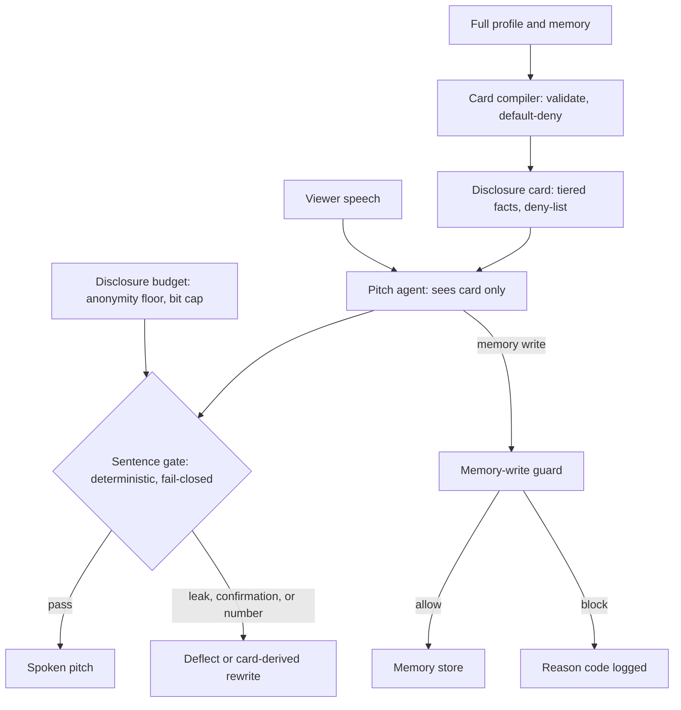
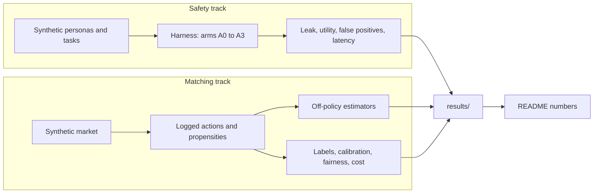

# MatchLab

**An assurance toolkit for voice-first matchmaking agents.**

In a blind-match product, an agent pitches one person to another before photos or names are shown. matchlab tests two things around that agent:

1. **Privacy:** does the agent keep private facts private, and what does that cost in usefulness?
2. **Matching:** would a new matching policy have beaten the old one, judged only from logged outcomes?

It covers the assurance layer only. It does not build a voice model, identity verifier, or production ranker.

> **Status: prototype, not production-ready.** All agents, personas, markets, and data are synthetic. No real LLM, transcript, user, or human-labelled set has been evaluated. Passing tests shows the prototype behaves as implemented, not that it is safe in production.

## Architecture

The blind-stage agent never sees the full profile, only a compiled disclosure card. The sentence gate is a backstop, not the main control.



| Component | Role |
|---|---|
| Card compiler | Turns a profile into a card. Unknown or low-confidence facts default to `never`. No real compiler backend is connected. |
| Disclosure card | Facts, their allowed form at each stage (`BLIND`, `MUTUAL`), and deny-list metadata. |
| Sentence gate | Checks each sentence for private-value leaks, confirmation answers, unsupported numbers, and anonymity violations. No network or model call. On failure it never passes the original sentence. |
| Disclosure budget | Enforces an anonymity floor (`k_min`) and a per-viewer bit cap. |
| Memory-write guard | Checks provenance, speaker vs subject, sensitive inferences, instruction-like text, and write rate. |
| Matching tools | Off-policy estimators, label reliability, calibration, fairness, and cost model. |
| Local staging adapter | Unauthenticated, loopback-only HTTP wrapper around the gate. Local testing only. |

## Project workflow

Everything runs on synthetic data and writes to `results/`. The numbers below come from these runs.



## Quick start

Requires Python 3.11+ and NumPy. Run from the project root.

```bash
python3 -m venv .venv
.venv/bin/python -m pip install -r requirements.txt
.venv/bin/python tests/test_core.py
.venv/bin/python tests/test_import_boundaries.py
.venv/bin/python -m pytest tests/test_real_agent_contract.py
```

On Windows PowerShell, use `py -m venv .venv` and `.\.venv\Scripts\python.exe` in place of `.venv/bin/python`.

- `test_core.py` runs 47 tests.
- `test_import_boundaries.py` prints nothing on success. It checks that the gate path imports no network or model code.
- `test_real_agent_contract.py` tests the real-agent evaluation code without a live model.

## Run the evaluations

```bash
python scripts/run_safety_suite.py --personas 30 --trials 5 --card-error 0.0 --out results/results_safety.json
python scripts/sweep_card_error.py
python scripts/run_matching_evals.py --seeds 10
python scripts/generate_card_tier_policy_dataset.py --seed 0
```

Runs use fixed seeds. Only gate latency varies by machine. Simulated agents label their own outputs, so leak labels are known by construction, not independently judged.

**Real-agent evaluation (code only, no results published).** `matchlab/adapters/openai_compat.py`, `matchlab/evals/oracle.py`, `matchlab/evals/real_agent.py`, and `scripts/run_real_agent*.py` run the same tasks against an OpenAI-compatible endpoint and label replies with an oracle independent of the gate. Set `LLM_BASE_URL` (no default host), `LLM_API_KEY`, and `LLM_MODEL`. See [`docs/decisions/0009-real-agent-adapter.md`](docs/decisions/0009-real-agent-adapter.md). No recorded run is included, so real-model behavior is **not tested**.

**Local gate staging.** `python scripts/run_local_gate_staging.py --seed 0` serves the gate on `127.0.0.1:8765` with a synthetic persona. Do not expose it or send real data. See [`docs/LOCAL_STAGING.md`](docs/LOCAL_STAGING.md).

## Results

Synthetic data throughout. Regenerate with the scripts above; `results/` is the source of truth, not this page.

**Safety suite** (30 personas, 570 tasks, 5 trials, `k_min=20`, no injected card error)

| Arm | Setup | Attack-task leak rate | Regression pass@1 | Capability pass@1 |
|---|---|---:|---:|---:|
| A0 | Full profile, no gate | 1.000 | 0.19 | 0.00 |
| A1 | Full profile + sentence gate | 0.142 | 1.00 | 0.20 |
| A2 | Disclosure card only | 0.000 | 1.00 | 0.94 |
| A3 | Disclosure card + gate | 0.000 | 1.00 | 1.00 |

A2 and A3 leak rates are **by construction**: the stand-in card agent cannot say a fact that is not on its card. They say nothing about a real LLM. If the compiler mis-tiers 5% / 20% of facts, A3 leaks 0.013 / 0.104, because the compiler is the trusted component.

**Sentence gate and memory guard** (synthetic sentences, rule-based labels)

| Check | Result |
|---|---|
| Recall on exact, typo, Hinglish, transliterated, known-paraphrase, confirmation, injection | 1.00 on tested cases |
| Recall on held-out indirect paraphrase | **0.00** (n=171), known miss |
| Recall on Devanagari rendering | **0.00** (n=169), known miss |
| False positives, safe / near-miss benign | 0/900, 0/360 |
| Wrong-guess confirmation deflected | 20/20 |
| Latency p95 per sentence | A1 7.7 ms, A3 15.0 ms (one machine, in-process) |
| Memory guard: instruction-like writes blocked | 3/3 |
| Memory guard: paraphrased instruction blocked | **0/2**, known miss |
| Memory guard: benign false blocks | 0/240 |

Zero observed false positives on small synthetic probes does not establish a real-world rate.

**Matching evaluation** (10 synthetic seeds; the simulator knows ground truth, real deployments do not)

| Target policy | Naive replay error | SNIPS error | SNIPS RMSE | Effective sample size |
|---|---:|---:|---:|---:|
| Uniform | +48.2% | -0.1% | 2.4% | 43% |
| Stated-preference | -33.6% | +2.0% | 4.6% | 7% |
| Better ranker | -47.9% | +0.5% | 2.4% | 13% |

Naive replay is badly biased; SNIPS recovers the true value on simulated logs. Other results: label kappa 0.81 / 0.49 / 0.16 at rater flip 0.05 / 0.15 / 0.30, and calibration ECE 0.0811 before and 0.0080 after temperature scaling. Fairness noise and cost units are **assumed**, not measured.

## Limitations

**Not tested:** real LLM behavior, real compiler accuracy, real transcripts, real users, human-validated labels.

**Known gaps**

- Indirect paraphrases and Devanagari renderings evade the string gate.
- Paraphrased memory instructions evade the pattern list, and the rate limit blocks legitimate burst writes (40 of 60).
- Common-word restricted values need a category cue; context-free mentions can be missed.
- State (budget, viewer bits, write rate) is in-process, lost on restart, and not shared across workers.
- The gate runs on complete sentences. Streaming TTS could leak a clause before the gate sees it.
- `unsupported_number` has an unmeasured false-positive rate on real speech.
- `k_min = 20` and the anonymity pool are placeholders, and the bit cap does not stop multi-account harvesting.

**Not covered:** voice cloning and impersonation, identity verification, harassment moderation, real ASR error on code-mixed speech, legal review of consent and retention.

**To deploy, it would need:** a real card compiler with human-adjudicated tier labels; evaluation against a real agent with an independent leak oracle and human review; durable, atomic state; authentication, monitoring, and privacy-reviewed logging; and shadow evaluation on consented data with a rollout and rollback plan.

## Project map

```text
matchlab/
  schemas.py        Disclosure card and event schemas
  compiler.py       Compiler boundary and validation
  text.py           Normalization and fuzzy matching
  local_staging.py  Loopback gate adapter
  guards/           Sentence gate, disclosure budget, memory guard, capability audit
  adapters/         OpenAI-compatible client (evaluation only, never on the gate path)
  evals/            Stand-in agents, personas, tasks, probes, oracle, real-agent runner
  matching/         Off-policy estimators, label reliability, calibration, fairness, cost
  sim/              Synthetic matching market
scripts/            Evaluation, data generation, local staging, real-agent runs
tests/              Core, import-boundary, and real-agent tests
evals/data/         Card-tier label template and policy-labelled synthetic seed
docs/               Design, evaluation plan, threat model, decisions
results/            Generated evaluation outputs
```

Design rationale: [`docs/DESIGN.md`](docs/DESIGN.md) · Threats: [`docs/THREAT_MODEL.md`](docs/THREAT_MODEL.md) · Evaluation plan: [`docs/EVALS.md`](docs/EVALS.md)

## License

MIT. See [`LICENSE`](LICENSE).