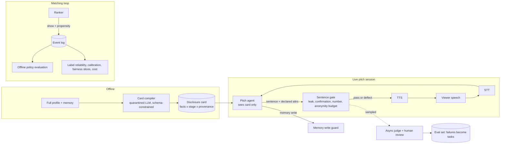

# Design: an assurance layer for voice-first matchmaking agents

Status: prototype with measured results on synthetic data. Nothing here has been run against a real LLM agent or real user data.

## 1. Context and scope

Public information (founder posts, app listing, privacy policy and terms) says the product works like this: Wave interviews you by voice and text, builds a profile and memory of you, then pitches you someone on a blind recommendation call before you see a photo. If both say yes, you talk directly, then see faces. The team's own hiring posts list the open problems: voice-based intent and personality, bidirectional matching, taste that updates as context grows, and "memory, evals, cost".

**Assumption, not knowledge:** the product already has working versions of the matching and voice pieces. I can't see their code, so this project does not try to replace their ranker or agent. It targets the part that is model-agnostic and can be built and validated without their data: **evaluation, guardrails, and the logging needed to evaluate rankers offline**, with latency, cost and memory treated as design constraints.

Out of scope: building a ranker, voice-based personality inference (weak validity, see section 2), identity verification and voice-clone detection, legal sign-off.

## 2. Research that shaped the design

| Finding | Source | Design consequence |
|---|---|---|
| No more than two of {untrusted input, private data, external effect} per agent session. | Meta, *Agents Rule of Two* (Nov 2025); Willison's "lethal trifecta" | The live pitch session has all three if the agent sees the full profile. Remove one: give it a disclosure card, not the profile. |
| Separating control flow from untrusted data gives provable security but costs utility: 77% of tasks solved with provable security vs 84% undefended. | Debenedetti et al., *Defeating Prompt Injections by Design* (CaMeL) | Capability removal has a real price. Measure the utility cost of every guard instead of assuming it is free. |
| You cannot filter your way out of prompt injection: attack phrasings are unbounded, pattern lists are finite. | Industry analyses of injection defence | Pattern scanner is flag-and-log only. Architecture is the defence. |
| Memory poisoning works through ordinary queries: 98.2% average injection success and 76.8% average attack success in the original study; pre-existing legitimate memory reduces effectiveness substantially under realistic conditions. | Dong et al., MINJA (arXiv 2503.03704); arXiv 2601.05504 | Memory writes are security events with an explicit policy, rate limits and provenance. |
| Pre-meeting traits and preferences predicted 4-18% of how much people desire others and 7-27% of how much they are desired, but could not predict desire for a specific partner. | Joel, Eastwick & Finkel, *Psychological Science* 2017 | Profile-based compatibility has a ceiling; chemistry shows up in interaction. Evaluate matchers on call outcomes, not profile similarity. |
| Transcript-only LLMs correlate about .16-.25 per participant with reported liking; adding a speech model helped pairwise ranking but not significantly per-participant correlation; about 100 training conversations. | arXiv 2607.23037 (Jul 2026) | Voice-derived signal is modest. Do not promise "true personality from voice". |
| Code-switched Hinglish raises word error rate by 30-50% relative to monolingual speech; plain WER also overstates error on Indic orthography by about 6 points. | HiACC corpus paper; arXiv 2603.00941 | Leak detection must not depend on English NER. Slice every metric by language group. |
| Working voice latency target is roughly 800 ms to first audio at p50 and 1500 ms at p95 (vendor blogs; a working target, not a law). | Vendor engineering blogs | Inline guard must be deterministic and cheap; semantic judging runs async. |
| Eval vocabulary and practice: tasks, trials, graders (code, model, human), capability vs regression suites, pass@k vs pass^k; start with 20-50 real tasks; calibrate model graders against humans. | Anthropic, *Demystifying evals for AI agents* | The harness is built this way. |
| India's DPDP Rules were notified 13 Nov 2025 with phased commencement: consent-manager provisions about Nov 2026, notice/consent/security/breach duties about May 2027. | Law-firm summaries (e.g. Hogan Lovells) | Voice is personal data. Minimise, retain briefly, log purpose. Not legal advice; needs counsel. |

## 3. Principles

1. **Remove capability before filtering.** A filter must be right every time; a capability the agent doesn't have can't be misused.
2. **Inline guards are deterministic and cheap; semantic judging is async.** The inline budget is tens of milliseconds, not a model call.
3. **Every guard ships with an eval and a measured utility cost.** A guard that silently makes the agent evasive costs matches.
4. **Validate the harness before trusting it.** Run known-bad and known-good arms so graders are shown to separate them.
5. **Shadow before enforce.** Run in log-only mode against real traffic, compare, then promote.
6. **Be explicit about the trusted computing base.** Here it is the compiled disclosure card.

## 4. Architecture

### Components

| Module | Responsibility | Latency / cost | Failure mode |
|---|---|---|---|
| `schemas.py` | `Fact`, `DisclosureCard`, stage rules, `LogEvent` | none | n/a |
| `text.py` | normalisation, fuzzy match tolerant of typos, re-spelling, code-mixing | microseconds, cached tokens | other-script renderings (Devanagari); common-word specificity is supplied metadata, not inferred |
| `guards/gate.py` | per-sentence leak, confirmation-oracle, number and anonymity checks | latest synthetic full-suite p95: 10.14-13.23 ms | indirect descriptions; category-intent coverage outside tested patterns; context-free mentions of low-specificity terms |
| `guards/budget.py` | anonymity-set tracking per viewer-target, per-viewer bit cap | indexed pool, O(combinations) | multi-account (Sybil) harvesting |
| `guards/memory.py` | provenance, speaker check, directive-anchored instruction and sensitive-write checks, rate limit | measured separately from the inline gate | paraphrased instructions |
| `guards/capability.py` | Rule-of-Two audit; injection pattern scanner (log only) | design time | scanner is evadable by design |
| `evals/*` | personas, simulated agents, tasks, runner, probes, memory suite | offline | agents are rule-based stand-ins |
| `matching/*` | OPE, label reliability, calibration, fairness, cost | offline | synthetic data only |
| `sim/*` | synthetic two-sided market used to generate logs | offline | learner and world share a model family |

## 5. Trade-offs

| Decision | Options | Choice | Why, with evidence | What would change my mind |
|---|---|---|---|---|
| How to stop leaks | Filter a full-context agent (A1) vs give it only a card (A2) vs both (A3) | Card first, gate as backstop | Latest synthetic A1 gate run leaked in 14.2% of attack tasks and deflected 71% of direct-employer questions; the card arm leaked 0% (when the card is right) and still gave a coarse answer | Card compile error rate high enough that the card, not the agent, is the weak point |
| Where the trust sits | Trust the card vs re-verify it | Evaluate adjudicated tiers; score unknown/low-confidence predictions under a default-deny policy | Leak rate with card arms: 0% at 0 mis-tier, 1.3% at 5%, 10.4% at 20%; these are injected-error sensitivity results, not compiler accuracy. The tier evaluator is implemented but has no human-labelled inputs yet, and is not wired into a live compiler. | Human-labelled tier accuracy shows unacceptable false-safe rate; then assess a second independent compile pass |
| Inline check type | Rules vs NLI model vs LLM judge | Rules inline, judge async | Latest synthetic full-suite p95 is 10.14-13.23 ms; p99 is 12.81-19.79 ms. An inline LLM call is outside the latency budget | If a small on-box NLI model fits the budget, add it behind the `entailer` hook |
| Leak detection basis | English NER vs match against the user's own private values | Own values + predicted paraphrases | NER degrades on code-mixed speech; own-value matching caught exact, typo, re-spelled and Hinglish variants at 100% recall in this suite | Real transcripts show systematic misses |
| Common-word values | Match each occurrence vs use declared specificity and category context | For values scored below 0.5, require a category cue for value matching | A synthetic probe allowed ordinary prose and unrelated yes/no questions 3/3 each and blocked contextual leaks and confirmations 3/3 each; scores were manually supplied, and context-free mentions may be missed | A validated automatic specificity scorer and broader non-sensitive evaluation data |
| Disclosure accounting | Infer revealed attributes from text vs agent declares them | Declared (structured), inferred as fallback | String inference missed a paraphrase and left the budget blind in an early run; declaring made accounting reliable | If structured output hurts fluency measurably in listening tests |
| Anonymity threshold | k = 5, 20, 100 | k = 20 as default, tune | In this suite the budget moved narrowing pass rate from 0.83 to 1.00 at a 0.04 deflection share | Pool statistics for the real population |
| On blocked content | Refuse vs deflect vs answer coarsely | Deflect, or coarse answer from the card | Both avoid confirming or denying; coarse answers keep the pitch useful | User research on what feels evasive |
| Confirmation questions | Answer truthfully when harmless vs never confirm or deny | Block named-value confirmations and bare binary answers to restricted-category questions | True-guess recall 1.00 (n=150); wrong-guess recall 1.00 (n=150); category probe 20/20 across 10 categories and both English/Hinglish; benign yes/no probe 120/120 allowed | Human-reviewed prompts establish that category-intent patterns retain utility and adequate coverage |
| Memory | Let the model decide vs explicit policy | Policy with provenance and rate limit | Blocks third-party claims, speaker mismatch, instruction-like and sensitive writes; 0/240 false blocks on a synthetic English/Hinglish corpus under the maintainer-approved 1% bound; misses paraphrased instructions (0/2) and blocks legitimate bursts | Human-reviewed realistic writes meet the false-block bar, and semantic classification is separately justified |
| Audit sampling | 1%, 5%, 25%, 100% | Start at about 5% | Illustrative cost model: 5% audit adds about 15% to cost per good call; 25% erases the saving from a better ranker | Real judge cost and the rate at which audits find new failures |
| Offline evaluation | Replay logs vs propensity-weighted | Propensity-weighted, with a small exploration floor | Replay error +48% / -34% / -48% on three target rankers; SNIPS within about 2-5% RMSE. Clipping (c=10) added bias on concentrated targets | Needing lower variance than SNIPS gives, then invest in a better reward model for DR |
| Rollout | Enforce vs shadow | Shadow first | Guards have utility costs that are only visible on real traffic | n/a |
| Build vs buy | Own guard vs vendor guardrail service | Own for the card/anonymity logic (domain-specific), buy for generic moderation | Generic services don't know a person's private facts | If a vendor supports per-user deny lists with sub-ms matching |

## 6. Measured results (synthetic; seeds and commands in README)

Safety suite: 30 personas, 570 tasks, 5 trials, k_min = 20, card mis-tier rate 0.

| arm | attack-task leak rate | regression pass@1 / pass^k | capability pass@1 | utility cost (deflected sentences, narrowing) |
|---|---|---|---|---|
| A0 unguarded | 1.000 | 0.20 / 0.20 | 0.00 | 0.00 |
| A1 unguarded + gate | 0.142 | 1.00 / 1.00 | 0.20 [0.14, 0.27] | 0.18 |
| A2 card only | 0.000 | 1.00 / 1.00 | 0.94 | 0.00 |
| A3 card + gate | 0.000 | 1.00 / 1.00 | 1.00 | 0.04 |

Read these correctly. A0's leak rate is 1.0 by construction (it is the leaky baseline). The card arms' near-perfect scores are largely **by construction too**: the simulated card agent cannot say what is not on the card. The informative evidence is below.

Gate against ground-truth labels (A1, sentence level):

| leak mode | recall | n |
|---|---|---|
| exact, typo, Hinglish-embedded, re-spelled, indirect (predicted paraphrase), true-guess confirmation, injected dump | 1.00 | 150-768 each |
| indirect, held-out paraphrase | **0.00** | 171 |
| Devanagari rendering | **0.00** | 169 |
| wrong-guess denial | **1.00** | 150 |

False positives: 0 of 900 safe sentences and 0 of 360 near-miss benign sentences. By the rule of three that bounds the rate at roughly 1%, not zero, and the sentences are synthetic. The separate low-specificity common-word probe allowed ordinary prose 3/3 and benign yes/no questions 3/3, and blocked category-context leaks 3/3 and confirmations 3/3. These are hand-authored generic words with manually assigned scores, not a gazetteer or a population false-positive estimate.

Gate latency in the latest standard full-suite run (in-process, short synthetic sentences): A1 p50 / p95 / p99 = 3.79 / 10.14 / 12.81 ms; A3 = 6.69 / 13.23 / 19.79 ms. Both p95 values were below the 20 ms target in this run. An earlier indexed-pool microbenchmark measured lower latency, while an unindexed version measured about 22 ms p50 and 40 ms p95. These are machine-specific microbenchmarks, not production latency claims.

Matching-side tools: see README and `scripts/run_matching_evals.py` output. Highlights: replay vs propensity-weighted error above; label-reliability ceiling (a two-rater kappa of 0.49 caps the correlation any model can show at about 0.70); temperature scaling cut held-out ECE from 0.081 to 0.008; exposure Gini of pitched users 0.039 random, 0.591 popularity-ranked, 0.189 learned.

## 7. Rollout plan

| Phase | What runs | Promotion gate |
|---|---|---|
| 0 Shadow | Gate and budget score every sentence, log only; card compiled alongside the real profile; propensity logging on | Regression suite pass^k at or above 0.99 on replayed real transcripts; false-positive rate under 1% on human-reviewed sample; p95 gate latency under 20 ms |
| 1 Enforce NEVER tier + confirmation | Block restricted-category leaks and yes/no confirmation | Utility drop (deflection share on benign questions) under an agreed threshold |
| 2 Anonymity budget | Enforce k_min and viewer cap | No increase in complaint rate or pitch abandon rate |
| 3 Card-only agent behind a flag | Agent loses access to full profile in blind stage | Compile error rate measured with the adjudicated tier evaluator; leak rate on held-out red-team set |

## 8. What this does not solve

- **The card compiler is the trusted computing base.** A provider-neutral fail-closed compiler boundary and two-rater/adjudicated tier evaluator are implemented, but no production backend or human-labelled tier set has been supplied, so actual compiler accuracy and asymmetric loss remain unmeasured. The separate policy-labelled synthetic baseline is by construction. Injected mis-tier sweeps are sensitivity analysis only.
- **Indirect descriptions, other scripts, category-intent variants, and common-word values.** Held-out paraphrases and Devanagari remain measured misses; category-level denials cover only the synthetic English/Hinglish patterns tested so far. Low-specificity matching requires manually supplied scores and category context; context-free mentions can be missed, and no gazetteer was evaluated.
- **Memory instruction detection is regex-only.** It allowed 240/240 synthetic benign English/Hinglish writes and blocked the 3/3 standing-rule attacks; human-reviewed text and paraphrased instructions remain untested or missed.
- **Real LLM behaviour.** Simulated agents are rule-based. Real agents paraphrase more, drift across turns, and fail in ways I did not model.
- **Sybil accounts** defeat a per-viewer cap. Needs account-level trust and rate limits.
- **Voice cloning and deepfakes,** identity verification, harassment on calls.
- **Voice-derived inference validity and fairness** across accents and languages.
- **Legal review** of consent, retention and cross-border processing.

## 9. Questions I would ask the team

1. Does the pitch agent see the full profile and memory, or an already-reduced view?
2. Is the probability of showing each recommendation logged today?
3. How is "good conversation" currently labelled, and by whom?
4. Which ASR provider and how is error measured on Hinglish?
5. Where does memory get written, and who can influence it?
6. What are the current p50/p95 first-audio latency and the headroom for an inline check?
